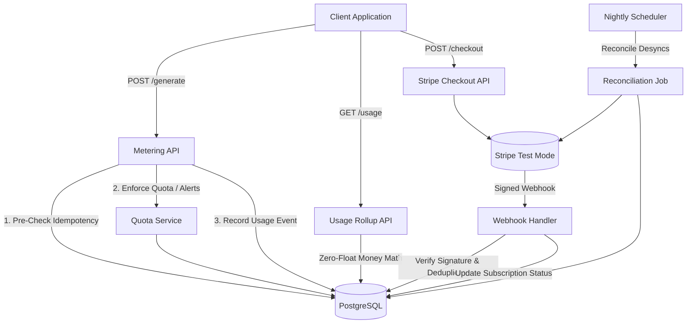

# Usage Metering & Billing Engine

Production-grade, idempotent SaaS usage metering, quota enforcement, and Stripe billing engine built with **Node.js, Express, and PostgreSQL**.

---

## 1. System Architecture



---

## 2. Subscription Plans & Quotas

| Plan | Monthly Cost | API Calls Quota | AI Tokens Quota | Behavior at Boundary |
| :--- | :--- | :--- | :--- | :--- |
| **Free** | $0.00 | 1,000 / month | 100,000 / month | Hard reject with `429 Too Many Requests` |
| **Pro** | $20.00 | 10,000 / month | 1,000,000 / month | Soft boundary: Allowed into Overage ($0.05/call, $10/1M tokens) |

---

## 3. Key Capabilities & Implemented Bonus Stages

1. **Idempotent Metering (Probe 1)**: Guaranteed exactly-once event recording enforced via database unique constraints on `(tenant_id, idempotency_key)`. Retries mirror the original response without double-counting.
2. **Boundary Honesty (Probe 2)**: Rejects over-quota calls with `429 Too Many Requests` and lapsed/unpaid subscriptions with `402 Payment Required`.
3. **Zero-Float Money Math (Probe 5)**: Integer arithmetic in micro-cents ($1.00 = 100,000,000 micro-cents) handles complex AI token tiers:
   - Fresh Input: 350 micro-cents / token ($3.50 / 1M)
   - Cached Input: 175 micro-cents / token ($1.75 / 1M - discounted)
   - Output & Reasoning: 1,050 micro-cents / token ($10.50 / 1M)
4. **Stripe Test Mode & Signature Verification (Probe 3 & 4)**: Cryptographically verifies Stripe signatures (`stripe.webhooks.constructEvent`), deduplicates incoming webhook events, and automatically flips tenants from Free to Pro upon `checkout.session.completed`.
5. **Full Test Suite (Stretch Goal 1)**: Deterministic, automated integration test suite (`npm test`) covering all edge cases.
6. **Usage Alerts & Overage (Stretch Goal 2)**: Real-time threshold detection at 80% and 100% of quota; overage math for Pro users.
7. **Invoices / Monthly Statements (Stretch Goal 3)**: Detailed itemized statements with separate token and overage line items (`GET /invoices/current`).
8. **Mid-Cycle Proration (Stretch Goal 4)**: Exact millisecond-accurate proration engine for mid-cycle upgrades (`POST /subscriptions/preview-proration` & `POST /subscriptions/upgrade`).
9. **Nightly Stripe Reconciliation Job (Stretch Goal 5 & Background Job Requirement)**: Background audit comparing local database state against Stripe's view, with automatic retry and desync alerting.

---

## 4. Setup & Run Instructions

### Prerequisites
- Node.js v18+
- Docker & Docker Compose
- Stripe CLI (free, test mode only)

### Step 1: Environment Setup
```bash
cp .env.example .env
```
*(Populate your Stripe test keys in `.env`).*

### Step 2: Boot Database & Application
```bash
docker-compose up -d
npm run migrate up
npm run dev
```

### Step 3: Seed Plans
```bash
curl -X POST http://localhost:3000/api/plans/seed
```

### Step 4: Local Stripe Webhook Forwarding
```bash
stripe listen --forward-to localhost:3000/webhooks/stripe
```

---

## 5. Automated Verification & Testing

Run the full integration test suite with one command:
```bash
npm test
```

Run test verification scripts:
- `./test-idempotency.sh`: Verifies idempotency deduplication (Probe 1).
- `./test-quota.sh`: Verifies 999 vs 1,000 vs 1,001 quota boundaries (Probe 2).
- `./test-money-math.sh`: Verifies exact micro-cent token calculation (Probe 5).
- `npm run reconcile`: Triggers the background reconciliation audit.

---

## 6. Honest Limitations Note
- **Live Mode Exclusion**: Intentionally constrained to Stripe Test Mode; no real money or credit card numbers are ever processed.
- **In-Memory Caching**: Quotas are checked with transactional consistency against PostgreSQL. In a hyper-scale deployment, an in-memory Redis cluster with distributed leases would front the database.
